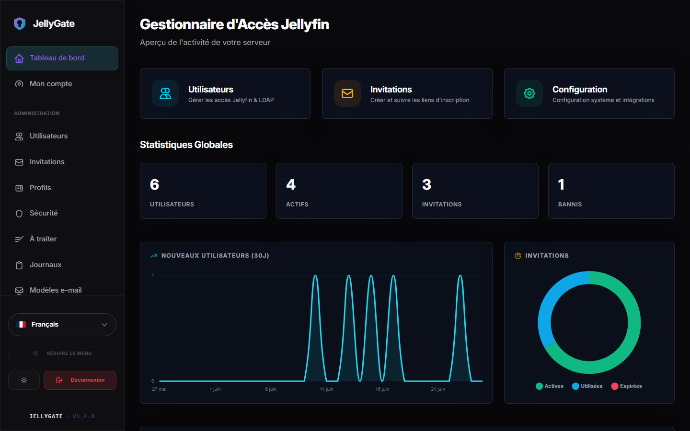
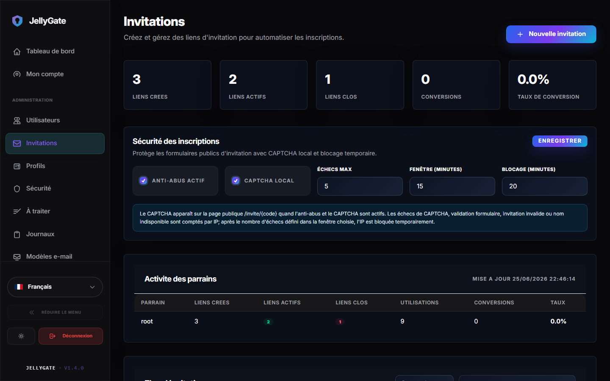
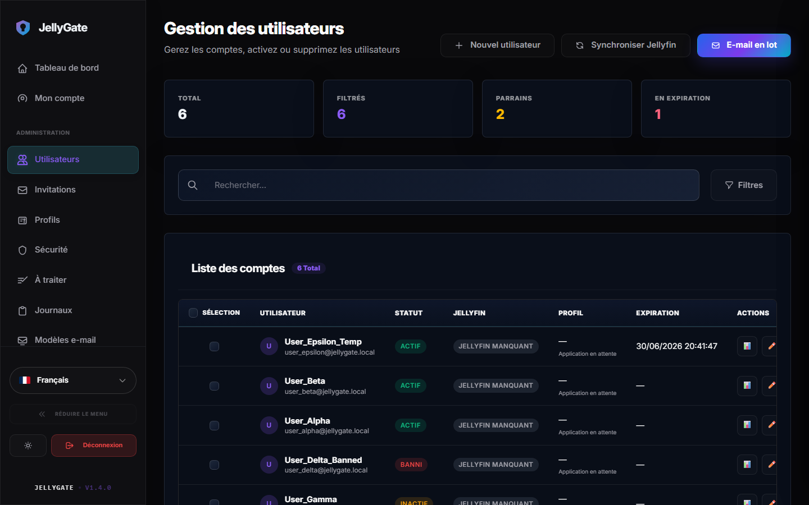
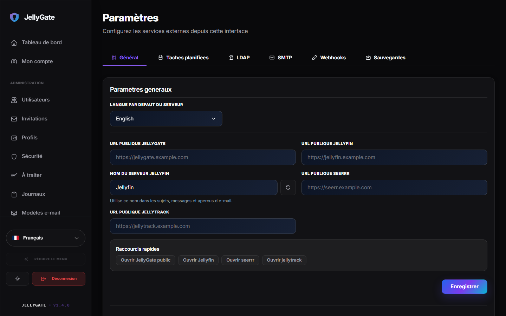
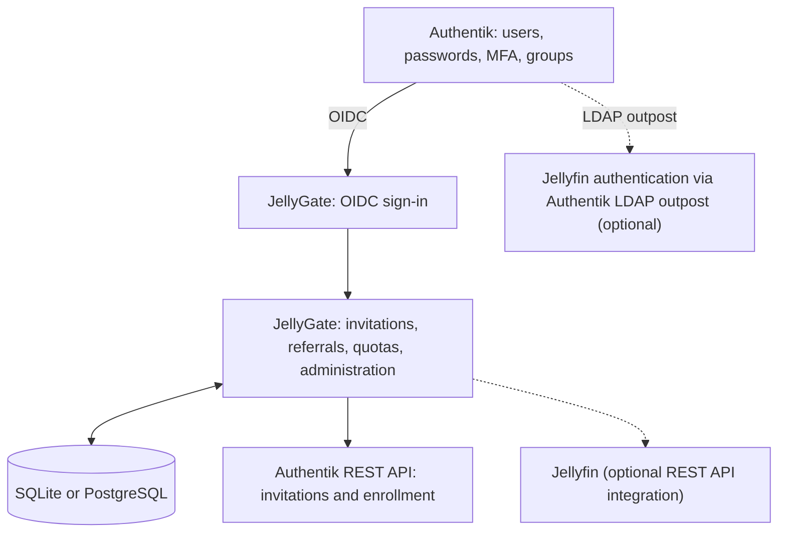

<p align="center">
  
</p>

<h1 align="center">JellyGate</h1>

<p align="center">
  <strong>Self-hosted user onboarding, invitations, referrals and access management — with Authentik as the identity provider.</strong>
</p>

<p align="center">
  <a href="https://github.com/maelmoreau21/JellyGate/actions/workflows/ci.yml"></a>
  <a href="https://github.com/maelmoreau21/JellyGate/actions/workflows/docker-publish.yml"></a>
  <a href="LICENSE"></a>
  <a href="https://ghcr.io/maelmoreau21/jellygate"></a>
</p>

> **Project scope:** JellyGate manages the onboarding and access lifecycle of users. **Authentik manages identities, passwords, MFA and authentication.** The Jellyfin API integration is optional; Jellyfin can authenticate against Authentik separately, for example through its LDAP outpost.
>
> This README describes the **`develop` branch**. The `main` branch and the `latest` container tag may not yet contain all features described here.

## Overview

JellyGate is a self-hosted administration and user portal built in **Go**. It combines invitations, referral relationships, quotas, user management, notifications and auditing in one interface, while using **OpenID Connect (OIDC)** for sign-in.

The current architecture is **Authentik-first**. JellyGate is not an LDAP server or an independent identity provider, and it does not need a configured Jellyfin API connection to start. An optional Jellyfin integration can provide user visibility and policy management when configured.

### Screenshots

| Dashboard | Invitations |
| --- | --- |
|  |  |
| Users | Settings |
|  |  |

Additional screenshots: [Login](docs/screenshots/login.png) · [Logs](docs/screenshots/logs.png)

## Features

- **Single sign-on:** OIDC Authorization Code flow with PKCE, OIDC token verification and Authentik group-based access to the portal.
- **Invitations and enrollment:** invitation links, expirations, usage limits, predefined profiles and integration with Authentik enrollment/invitation stages.
- **Referrals and quotas:** sponsor–invitee relationships, invitation permissions, per-user quota adjustments and referral tracking.
- **User and access administration:** user overview, access lifecycle, expiration actions, permission profiles, activity timelines and bulk actions.
- **Optional Jellyfin API integration:** user status, selected policy/profile features and library-related controls where supported. Jellyfin is **not required** for JellyGate to start.
- **Optional Jellyseerr provisioning** when its API connection is configured; **JellyTrack** can be linked from the portal. Do not confuse a portal link with automatic account provisioning.
- **Email and notifications:** SMTP, editable multilingual templates, reminders, and configurable notification/webhook integrations.
- **Automation:** scheduled tasks, housekeeping, invitation cleanup and access-expiration workflows.
- **Backups:** manual and scheduled backup archives for SQLite and PostgreSQL, with restore capabilities that depend on the storage backend.
- **Security controls:** non-root container, read-only root filesystem, request limiting, CSRF protection, session signing, audit logs and optional emergency local administrator.
- **10 UI languages:** English, French, German, Spanish, Italian, Dutch, Polish, Brazilian Portuguese, Russian and Chinese.
- **Database choice:** embedded **SQLite (pure Go, without CGO)** or an **external PostgreSQL** server.

Specific features may require additional services, credentials, permissions or setup in the administration interface.

## How it works



**Separation of responsibilities:** Authentik is the source of truth for identity; JellyGate stores application-specific business data. The Authentik LDAP outpost belongs to Authentik, **not** to JellyGate.

## Deployment

### Prerequisites

- Docker with the Compose plugin, or Go and frontend tooling if building manually.
- An accessible **Authentik OIDC provider** for the intended SSO setup.
- A publicly reachable or internal URL for JellyGate that matches the configured OIDC redirect URI.
- HTTPS with a reverse proxy for public-facing deployments.
- Jellyfin and PostgreSQL are optional.

### Option A — SQLite (simplest setup)

For the `develop` source and its matching Compose configuration:

```bash
git clone --branch develop https://github.com/maelmoreau21/JellyGate.git
cd JellyGate
cp .env.example .env
openssl rand -hex 32
```

Edit `.env` and **replace** `JELLYGATE_SECRET` with the generated value. The placeholder in `.env.example` is deliberately rejected by the application.

At a minimum, configure your real OIDC credentials and public URL:

```dotenv
JELLYGATE_BASE_URL=https://gate.example.com
JELLYGATE_SECRET=<your-generated-random-secret>
OIDC_ENABLED=true
OIDC_URL=https://auth.example.com/application/o/jellygate/
OIDC_CLIENT_ID=<your-client-id>
OIDC_CLIENT_SECRET=<your-client-secret>
OIDC_USER_GROUP=jellygate-users
OIDC_ADMIN_GROUP=jellygate-admins
DB_HOST=
```

Keep `DB_HOST` unset/empty and do not force `DB_TYPE=postgres`: JellyGate uses **SQLite** by default and stores its database in `/data/jellygate.db`. On the supplied Compose file, `/data` maps to `./data` on the host.

If you are not using the Jellyfin API integration, clear the example values for `JELLYFIN_URL` and `JELLYFIN_API_KEY` in `.env` so that placeholder credentials are not mistaken for a real connection.

Start JellyGate from the checked-out repository:

```bash
docker compose up -d --build
docker compose logs -f jellygate
```

Open the URL configured by `JELLYGATE_BASE_URL` (or `http://localhost:8097` for local development).

> **Important:** The source Compose file includes `build: .`. Downloading only `docker-compose.yml` and `.env.example` is **not** a complete source-build installation. Clone the repository as shown above, or use a separate image-only Compose configuration.

### Option B — External PostgreSQL

JellyGate can connect to a PostgreSQL server you already operate; you **do not** need to start a second PostgreSQL container.

In `.env`, configure:

```dotenv
DB_TYPE=postgres
DB_HOST=postgres.example.internal
DB_PORT=5432
DB_USER=jellygate
DB_PASSWORD=<your-database-password>
DB_NAME=jellygate
DB_SSLMODE=require
```

The database and its user must exist and be accessible to JellyGate. The appropriate `DB_SSLMODE` depends on your PostgreSQL server's TLS configuration. For a container on an isolated local Docker network without TLS, you may need `disable`; **do not use that for a connection over an untrusted network**.

Use the normal `docker-compose.yml` with the checked-out source and run `docker compose up -d --build`. The environment is supplied through `.env`.

**Database selection is not database migration.** Switching from SQLite to PostgreSQL changes the backend; it does not automatically copy existing JellyGate data. Back up your installation and use a verified migration procedure before changing an existing deployment.

### Option C — Bundled PostgreSQL container

The repository also contains `docker-compose.postgres.yml`, which uses `postgres:18-alpine` and a persistent PostgreSQL volume. Before deploying it, ensure its volume mount matches the **PostgreSQL 18+** layout:

```yaml
volumes:
  - postgres_data:/var/lib/postgresql
```

If you already have an initialized database, **do not blindly change an existing mount**. Verify the active data directory and the volume contents, then back up and plan a safe migration. See the [official PostgreSQL Docker image notes](https://hub.docker.com/_/postgres).

### Container tags and architectures

Images are published to `ghcr.io/maelmoreau21/jellygate` for `linux/amd64` and `linux/arm64`:

| Tag | Purpose |
| --- | --- |
| `latest` | Default-branch (`main`) image |
| `unstable` | Development-branch (`develop`) image |
| Version tags | Tagged releases, when published |

To use a prebuilt image, remove `build: .` from your own Compose file and set, for example, `image: ghcr.io/maelmoreau21/jellygate:unstable` for the development branch. Use `latest` for the default-branch build. Avoid relying on a floating tag for reproducible production upgrades.

## Authentik configuration

1. Create an **OAuth2/OpenID Connect provider** in Authentik with a confidential client.
2. Add the redirect URI: `https://gate.example.com/auth/callback` (replace the hostname with your `JELLYGATE_BASE_URL`).
3. Configure `OIDC_URL`, `OIDC_CLIENT_ID` and `OIDC_CLIENT_SECRET` in `.env`.
4. Create and assign the relevant groups, such as `jellygate-users` and `jellygate-admins`, and expose group membership in the OIDC claims.
5. For **invitation/enrollment management through the Authentik REST API**, additionally configure `AUTHENTIK_API_TOKEN` (or `OIDC_API_TOKEN`) and the appropriate enrollment flow and permissions. OIDC sign-in alone does **not** grant access to the Authentik management API.
6. Test the identity provider connection in JellyGate's Authentik settings.

Consult [Authentik setup](docs/AUTHENTIK_SETUP.md), [Authentik troubleshooting](docs/AUTHENTIK_TROUBLESHOOTING.md) and the [architecture overview](docs/ARCHITECTURE_AUTHENTIK.md).

## Configuration reference

The tracked [`.env.example`](.env.example) contains the starter configuration. Common settings:

| Variable | Purpose |
| --- | --- |
| `JELLYGATE_SECRET` | **Required.** Random secret for signed sessions, at least 32 characters. Generate with `openssl rand -hex 32`. |
| `JELLYGATE_BASE_URL` | Public URL used for links and OIDC callback. |
| `JELLYGATE_PORT` | Container's HTTP listener (default `8097`). |
| `PUID` / `PGID` | UID/GID used by the supplied Compose configuration; ensure `/data` is writable. |
| `OIDC_ENABLED` | Enable OIDC login (defaults to `true`). |
| `OIDC_URL` | OIDC issuer URL, usually your Authentik application provider URL. |
| `OIDC_CLIENT_ID` / `OIDC_CLIENT_SECRET` | OIDC client credentials. |
| `OIDC_USER_GROUP` / `OIDC_ADMIN_GROUP` | Portal access and admin group names. |
| `AUTHENTIK_API_TOKEN` | Authentik REST API token used by supported enrollment/admin operations. |
| `OIDC_ENROLLMENT_FLOW_SLUG` | Authentik enrollment flow identifier when needed. |
| `DB_TYPE` | `sqlite` or `postgres`; inferred from `DB_HOST` if omitted. |
| `DB_HOST` / `DB_PORT` | External PostgreSQL connection endpoint. |
| `DB_USER` / `DB_PASSWORD` / `DB_NAME` | PostgreSQL credentials and database name. |
| `DB_SSLMODE` | PostgreSQL TLS policy (`require`, `prefer`, `disable`, as appropriate). |
| `JELLYFIN_URL` / `JELLYFIN_API_KEY` | Optional Jellyfin REST API integration. |
| `JELLYSEERR_URL` / `JELLYSEERR_API_KEY` | Optional Jellyseerr account provisioning. |
| `JELLYTRACK_URL` | Optional JellyTrack portal link. |
| `JELLYGATE_LOCAL_ADMIN_USER` / `JELLYGATE_LOCAL_ADMIN_PASSWORD` | Optional emergency local admin; password is disabled by default and must be strong if enabled. |
| `JELLYGATE_TRUST_PROXY_HEADERS` / `JELLYGATE_TRUSTED_PROXIES` | Controls which proxy IPs are allowed to supply forwarded client IP headers. |
| `JELLYGATE_DEFAULT_LANG` | Force a supported default interface language. |

Some integrations, email templates and operational settings can also be administered in the web interface. See the actual source and example file for configuration precedence.

## Security and operations

- Put the public service behind **HTTPS** and restrict the set of trusted reverse-proxy IPs. Never trust arbitrary `X-Forwarded-For` headers.
- Use unique, random secrets. **Do not commit `.env`**, tokens or database backups to version control.
- Restrict write access to the persistent `/data` directory; it contains the SQLite database or application state and backup archives.
- Enable and verify backups; regularly test a restore procedure. PostgreSQL backups use `pg_dump`/`pg_restore` utilities included in the current runtime image.
- A local emergency admin is optional and should be enabled only with an appropriately protected password.
- `/health` is the container health endpoint. `/health/jellyfin` provides optional Jellyfin integration diagnostics.
- Keep Authentik, JellyGate and any connected Jellyfin server patched.

See [Security](docs/SECURITY.md), [Security hardening](docs/SECURITY_HARDENING.md), and [Backup and rollback](docs/BACKUP_ROLLBACK.md).

## Development

The backend is written in Go, with server-rendered templates and JavaScript/CSS frontend assets.

```bash
# From the repository root
go test ./...

# Frontend tooling (see package.json)
pnpm install --frozen-lockfile
pnpm run build:css
pnpm run i18n:validate

# Production-style local image build
docker build -t jellygate:local .
```

The project uses multi-stage Docker builds and a pure-Go SQLite driver. The build stage installs frontend dependencies, while the runtime image contains the application binary, web assets, CA certificates and PostgreSQL backup tools. The resulting image size depends on architecture, image layers and dependency versions.

## Documentation

- [Authentik setup guide](docs/AUTHENTIK_SETUP.md)
- [Authentik architecture](docs/ARCHITECTURE_AUTHENTIK.md)
- [Invitations and enrollment](docs/INVITATIONS.md)
- [Sponsorship and quotas](docs/SPONSORSHIP.md)
- [Migration from earlier versions](docs/MIGRATION.md)
- [Backup and rollback](docs/BACKUP_ROLLBACK.md)
- [Security hardening](docs/SECURITY_HARDENING.md)

## License

JellyGate is released under the [MIT License](LICENSE).
